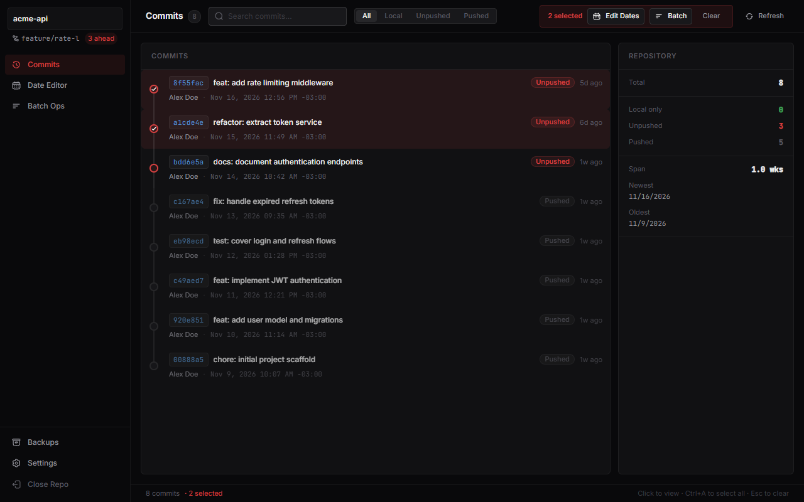
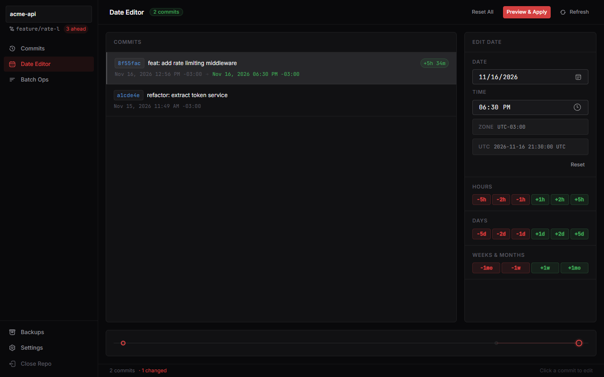

<div align="center">
  <h1>
    <br>
    LGCEdit
  </h1>

  <p>
    Editor de commits locais do Git para revisar e reescrever mensagens e datas de commits que ainda não foram publicados.<br>
  </p>

[](https://github.com/gabrielgriffo/local-git-commit-editor/releases/latest) [](LICENSE) [](https://v2.tauri.app/) [](https://angular.dev/)

  <p>
    <a href="https://github.com/gabrielgriffo/local-git-commit-editor/releases/latest">
      </a>
  </p>

</div>

O LGCEdit (Local Git Commit Editor) é um aplicativo desktop para Windows e Linux que permite revisar o histórico de um repositório Git local e reescrever a mensagem e as datas de commits que ainda não foram enviados a um remoto. As alterações são exibidas em pré-visualização antes de serem aplicadas, e um backup do estado anterior é criado automaticamente. Todas as operações são executadas sobre o repositório presente no disco: o aplicativo não realiza push, fetch nem qualquer outro acesso à rede.

## Início rápido

1. **Instale o aplicativo.** Na página de [releases](https://github.com/gabrielgriffo/local-git-commit-editor/releases/latest), baixe o instalador correspondente ao sistema:

   - **Windows:** instalador `.exe` ou `.msi`. Caso o SmartScreen exiba "O Windows protegeu o computador", selecione **Mais informações** e depois **Executar assim mesmo**.
   - **Linux:** pacote `.deb` ou `.rpm`, ou o arquivo AppImage.

   ```sh
   sudo apt install ./LGCEdit_<versão>_amd64.deb
   ```

2. **Abra um repositório.** Informe o caminho da pasta do repositório ou selecione-a em **Browse** e clique em **Open Repository**. Os três últimos repositórios abertos ficam disponíveis na tela inicial.

3. **Edite os commits.** Na lista de commits, clique em um commit para editar a mensagem ou a data de autoria, ou selecione vários commits e utilize **Edit Dates** (datas individuais) ou **Batch** (mesmo deslocamento para todos).

4. **Confirme a reescrita.** Revise a pré-visualização e clique em **Apply**. Antes da reescrita, o estado atual da branch é salvo em um backup, que pode ser restaurado na tela **Backups**.

## Interface

<p align="center">
  
</p>

<p align="center">
  
</p>

## Funcionalidades

- **Navegação pelo histórico.** Lista os commits da branch atual com busca por mensagem, autor ou hash e filtros por estado: local, não publicado e publicado.
- **Edição de mensagem.** Reescreve o título e o corpo de um commit, com comparação lado a lado entre a versão original e a nova antes da aplicação.
- **Edição de datas.** Define a data de autoria de um ou mais commits ou a desloca por horas, dias, semanas e meses. A data do committer acompanha o mesmo deslocamento, preservando o intervalo original entre as duas.
- **Fuso horário do commit.** As datas são exibidas e editadas no fuso registrado em cada commit, o mesmo apresentado pelo `git log`, com o deslocamento em relação ao UTC indicado ao lado.
- **Operações em lote.** Aplica o mesmo deslocamento de data a vários commits selecionados, com pré-visualização do resultado de cada um.
- **Proteção de commits publicados.** Commits alcançáveis por qualquer branch remota são somente leitura na interface, e o backend recusa reescrevê-los.
- **Avisos de impacto.** A confirmação informa quando a reescrita remove assinaturas GPG/SSH ou quando tags e outras branches continuarão apontando para os commits antigos.
- **Backups.** Antes de cada reescrita, o estado da branch é salvo automaticamente. A restauração devolve a branch ao commit salvo e preserva o estado atual em um novo backup.
- **Execução local.** Não há conta, servidor intermediário, telemetria nem verificação de atualizações. As fontes da interface são distribuídas com o aplicativo, e nenhum recurso é carregado da rede.

## Configurações

As opções ficam na tela **Settings** e são armazenadas localmente, no armazenamento do próprio aplicativo.

| Opção | Descrição |
|---|---|
| Commits to load | Quantidade máxima de commits carregados por repositório: 50, 100, 200 (padrão) ou 500. |
| Confirm before applying | Exibe a pré-visualização e solicita confirmação antes de cada reescrita. Quando desativada, a alteração é aplicada imediatamente. |
| Auto-backup before edits | Cria um backup da branch antes de cada reescrita. Quando desativada, nenhum backup automático é gerado. |

Os estados dos commits são indicados por cor na lista: **Local** (repositório sem remoto), **Unpushed** (commit ainda não presente em nenhuma branch remota) e **Pushed** (commit já publicado, somente leitura).

## Atalhos

| Atalho | Ação |
|---|---|
| Ctrl+A | Seleciona os commits exibidos na lista (respeitando busca e filtro). Uma segunda execução limpa a seleção. |
| Esc | Limpa a seleção, cancela a edição em andamento ou fecha o diálogo de confirmação. |

## Limitações conhecidas

- **Somente a branch atual.** A edição considera a linha principal (primeiro pai) da branch em uso. Commits que pertencem apenas a uma branch mesclada não podem ser reescritos.
- **Detecção baseada nas referências locais.** Um commit é considerado publicado quando está presente em alguma branch remota conhecida localmente (`refs/remotes/*`). Como o aplicativo não executa fetch, mantenha essas referências atualizadas antes de editar.
- **Assinaturas.** Commits assinados dentro do intervalo reescrito perdem a assinatura, pois ela deixa de ser válida após a reescrita.
- **Referências adicionais.** Apenas a branch atual é atualizada. Tags e outras branches que apontam para commits reescritos permanecem nos commits originais.
- **Repositórios não suportados.** Repositórios bare e branches sem nenhum commit não podem ser abertos.
- **Instalador sem assinatura.** O SmartScreen e alguns antivírus podem solicitar confirmação na primeira execução.

## Detalhes técnicos

<details>
<summary><strong>Reescrita do histórico</strong></summary>

Editar a mensagem ou a data de um commit altera o seu identificador e, consequentemente, o de todos os commits posteriores na branch. O LGCEdit recria o commit editado e cada um dos seus descendentes, copiando byte a byte tudo o que não foi alterado: nomes, e-mails, codificação declarada, cabeçalhos adicionais e o conteúdo das mensagens. Ao final, apenas a referência da branch atual (ou o HEAD destacado) é atualizada.

Antes de aplicar, o backend verifica se todos os commits do intervalo ainda não foram publicados e se os commits selecionados pertencem à linha principal da branch. Caso alguma condição não seja atendida, a operação é recusada sem alterar o repositório.

> [!WARNING]
> Reescrever commits já compartilhados exige force push e afeta todas as pessoas que trabalham na branch. Utilize o LGCEdit em commits que ainda não foram publicados e mantenha o backup automático ativado.

</details>

<details>
<summary><strong>Backups</strong></summary>

Cada backup registra a branch, a referência completa e o commit da ponta em um arquivo JSON no diretório `lge-backups` do repositório (`.git/lge-backups/`, compartilhado entre worktrees). Uma referência `refs/lge-backups/<id>` mantém o commit salvo acessível, de modo que ele não é removido pela coleta de lixo do Git enquanto o backup existir.

A restauração cria primeiro um backup do estado atual e então move a branch para o commit salvo. Quando a branch restaurada é a que está em uso e o conteúdo dos arquivos difere, o índice é atualizado para refletir o commit restaurado; os arquivos da área de trabalho não são alterados. Se houver alterações preparadas para commit (staged) que seriam perdidas, a restauração é recusada. Backups criados com o HEAD destacado são restaurados também com o HEAD destacado.

A exclusão de um backup remove o arquivo e a referência correspondentes e exige confirmação.

</details>

<details>
<summary><strong>Datas e fusos horários</strong></summary>

O Git armazena cada data como um instante em UTC acompanhado do deslocamento do fuso em que o commit foi criado. O LGCEdit exibe e interpreta as datas nesse deslocamento, de forma que o horário informado no editor corresponde exatamente ao horário apresentado pelo `git log`. O deslocamento original é preservado na reescrita, e o editor apresenta também o instante equivalente em UTC.

Na edição da data de autoria, a data do committer recebe o mesmo deslocamento, mantendo o intervalo existente entre as duas (comum em commits que passaram por rebase ou cherry-pick).

</details>

<details>
<summary><strong>Segurança e dados locais</strong></summary>

O aplicativo não possui servidores, backends intermediários, telemetria nem mecanismos de coleta de dados. Toda operação ocorre sobre o repositório já presente no disco, por meio da biblioteca libgit2, compilada sem suporte a HTTPS e SSH.

A interface é executada com uma Content Security Policy restrita ao próprio aplicativo, e os identificadores recebidos pelo backend, como o de um backup, são validados antes de qualquer acesso ao sistema de arquivos. As preferências ficam no armazenamento local do aplicativo e não saem da máquina.

</details>

<details>
<summary><strong>Compilação</strong></summary>

Pré-requisitos:

- [Node.js](https://nodejs.org/) 20 ou superior
- [Rust](https://www.rust-lang.org/tools/install) com o toolchain `stable`
- [Pré-requisitos do Tauri](https://v2.tauri.app/start/prerequisites/) para o sistema operacional
- No Linux: `pkg-config`

```sh
# Instala as dependências
npm install

# Inicia o ambiente de desenvolvimento (Angular + Tauri)
npm run tauri dev

# Inicia apenas o frontend Angular (http://localhost:1420)
npm run start

# Executa os testes do frontend e do backend
npm test
npm run test:rust

# Gera o build de produção
npm run tauri build
```

Os arquivos de distribuição são gerados em `src-tauri/target/release/bundle/`. As versões publicadas são produzidas pelo workflow `.github/workflows/release.yml` a partir de tags no formato `vX.Y.Z`.

O código é dividido em duas partes. `src/` contém a interface em Angular 20 e TypeScript: serviços de acesso ao backend, telas de commits, edição, lote, backups e configurações, além das funções de data e fuso em `src/app/core/utils/`. `src-tauri/` contém o backend em Rust e Tauri 2: `git_ops.rs` lê e reescreve commits por meio da biblioteca [`git2`](https://crates.io/crates/git2), `backup.rs` gerencia criação, listagem e restauração de backups, e `lib.rs` registra os comandos expostos à interface.

</details>

## Licença e créditos

Distribuído sob a licença MIT. Consulte [LICENSE](LICENSE).

O projeto utiliza ícones do conjunto [Solar Icons](https://icon-sets.iconify.design/solar/) e as fontes Inter e JetBrains Mono. Os créditos e as respectivas licenças estão em [THIRD-PARTY-NOTICES.md](THIRD-PARTY-NOTICES.md).

MIT © [Gabriel Griffo](https://github.com/gabrielgriffo)
